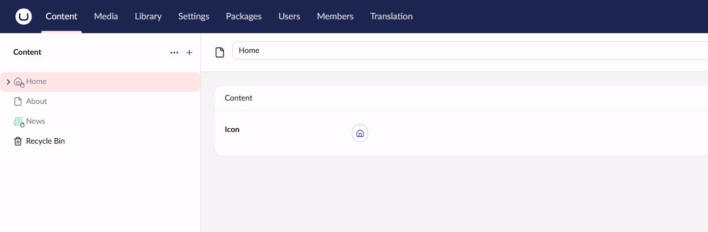

# NodeIcons

Choose a different icon for each document in Umbraco's native content tree and document pickers.

[Installation, configuration and usage](docs/nuget-readme.md) · [Issues](https://github.com/skttl/umbraco-node-icons/issues)



## Development

`v18/main` targets Umbraco 18 and package 18.x; `v17/main` targets Umbraco 17 and package 17.x. Both use .NET 10. Umbraco 19 support has not been evaluated. Use a maintained Umbraco patch release within your supported major in real sites. Minimum-version verification deliberately uses 18.0.0, whose upstream dependency advisories should be addressed by updating the host CMS.

Install .NET SDK 10 and Node.js 24.13 or newer with npm 11 or newer. NuGet consumers do not need Node.js.

- `src/Umbraco.Community.NodeIcons`: Razor package and Vite client.
- `tests/Umbraco.Community.NodeIcons.Tests`: server tests.
- `demo/Umbraco.Community.NodeIcons.TestSite`: official SQLite demo with a project reference.
- `buildTransitive/`: native Umbraco appsettings schema registration.
- `scripts/verify-package.ps1`: checks the actual NuGet artifact, shared by CI and publishing.

From the repository root:

```powershell
npm --prefix src/Umbraco.Community.NodeIcons/Client ci
npm --prefix src/Umbraco.Community.NodeIcons/Client test
npm --prefix src/Umbraco.Community.NodeIcons/Client run typecheck
npm --prefix src/Umbraco.Community.NodeIcons/Client run build
dotnet build Umbraco.Community.NodeIcons.slnx -c Release
dotnet test tests/Umbraco.Community.NodeIcons.Tests -c Release --no-build
dotnet pack src/Umbraco.Community.NodeIcons -c Release --no-build -o artifacts
pwsh -File scripts/verify-package.ps1 artifacts/Umbraco.Community.NodeIcons.18.0.0.nupkg 18.0.0
dotnet run --project demo/Umbraco.Community.NodeIcons.TestSite
```

The default launch profile uses Development settings and installs the demo's SQLite database automatically on first run. Visit `/umbraco` at the URL printed by `dotnet run` and sign in with `nodeicons@example.test` / `NodeIcons-Demo-Only-493!` (display name **NodeIcons Demo**). These public credentials are for the local demo only; do not use them on a deployed site. They are configured in the demo's `appsettings.Development.json`.

Follow the usage guide to add a data type and invariant property. The demo starts without customer document types. Keep local databases and generated content out of Git.

## Demo provenance

The demo was generated with official `Umbraco.Templates` 18.0.0, after inspecting its help and a dry run. The template fixes the framework to net10.0 and does not expose a framework parameter. Its generated ICU, runtime and development settings are retained.

```powershell
dotnet new install Umbraco.Templates::18.0.0 --debug:custom-hive <isolated-hive>
dotnet new umbraco --debug:custom-hive <isolated-hive> --name Umbraco.Community.NodeIcons.TestSite --output demo/Umbraco.Community.NodeIcons.TestSite --development-database-type SQLite --package-management PerProject --no-restore --no-update-check
```

The 17.0.0 template uses per-project references by default; omit `--package-management PerProject` there.

## Release setup

Client builds stamp `umbraco-package.json` from the project version. For a local prerelease, set `$env:RELEASE_VERSION="18.0.1-beta.2"` before `npm run build` and use the same `-p:Version=18.0.1-beta.2` for .NET build/pack; clear the environment variable afterward.

Build and verify the package before creating a stable or prerelease version tag. Package majors follow Umbraco majors and dependencies exclude the next major. Releases use NuGet trusted publishing with GitHub OIDC. Configure a GitHub `release` environment and `NUGET_USER` secret containing the NuGet account name. Configure the NuGet trust policy for `skttl/umbraco-node-icons`, workflow `publish.yml`, environment `release`, and package ownership. No permanent NuGet API key is needed. The trust policy must use the exact filename `publish.yml` (not the display name or `.github/workflows/` path), repository owner `skttl`, repository `umbraco-node-icons`, and environment `release`. The NuGet account must own the package. `NUGET_USER` is the profile username, not an email address. The publishing job grants `id-token: write` and `contents: read`; CI grants only `contents: read`.

CI runs locked client installation, tests, type checking and build, followed by solution restore/build, server tests, pack and the shared package verifier. Publishing repeats these checks before exchanging OIDC credentials immediately before pushing. Tags must be complete stable or prerelease SemVer such as `v18.0.0`, `v18.0.1-rc1` or `v18.0.1-beta.2`; numeric prerelease identifiers cannot have leading zeros. Build metadata is outside this release tag format. Only the leading `v` is removed. Tag major, project package major and the exclusive Umbraco dependency interval must agree. The tagged commit must be an ancestor of the fetched `origin/v18/main` (18) or `origin/v17/main` (17) tip. Only the expected remote version branch is fetched; each major releases independently. `scripts/test-release-validation.ps1` exercises acceptance and rejection without contacting a remote.

Before first publication, run the Release pack command above and `scripts/verify-package.ps1`, then install the artifact in a separate official-template site at the declared CMS minimum. Configure the external environment and trust policy before authorizing any workflow publication. Creating a tag and publishing require an explicit release decision.

MIT license. Artwork uses a tree with a star node in the package palette.
